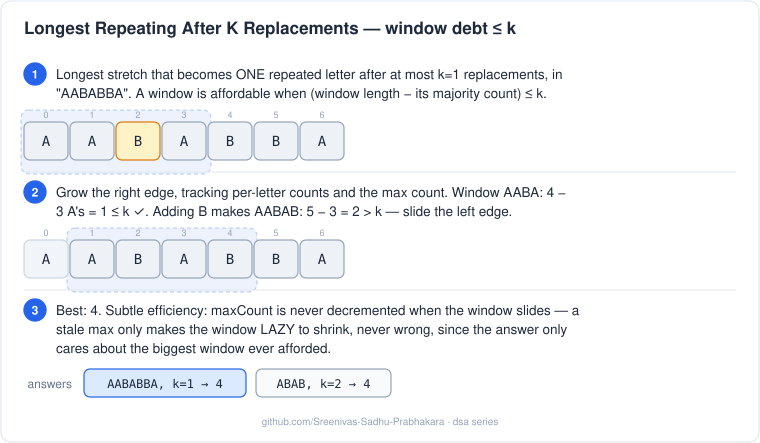

# Longest Repeating Character Replacement

> NeetCode 150 · Sliding Window · Blind 75 — window viable while size − maxFreq ≤ k; the famous subtlety is that maxFreq may go stale without harming the answer. Go, stdlib only, tested.

## Problem

Choose a substring and change at most k of its characters so all become equal; maximize its length. `"AABABBA", k=1` → 4.

## Approach

A window needs `size − (count of its majority letter) ≤ k` changes to become uniform. Slide the right edge, maintain per-letter counts and `maxFreq`, and when the condition breaks, advance the left edge *once* — the window never shrinks below the best already achieved. The celebrated subtlety: `maxFreq` is **never recomputed downward** when the window slides, so it can exceed the current window's true majority. That staleness is harmless — the answer only improves when a window *larger* than the previous best becomes valid, which requires `maxFreq` to genuinely grow; stale values merely keep the window at its record size, never inflate the result. That one observation turns an O(26·n) recompute into O(n).

**Complexity:** O(n) time, O(26) space.

## Visual walkthrough

Read the picture top to bottom — each numbered frame is one moment of the algorithm
running on this repo's test example.

## Run

    go test ./...   # verify
    go run .        # demo

---

Part of a 275-repo DSA series in Go — Striver's SDE Sheet (dsa-001–191) plus the NeetCode 150 / Blind 75 additions (dsa-192–275), stdlib only, every solution tested. Browse: [`dsa-*` repos](https://github.com/Sreenivas-Sadhu-Prabhakara?tab=repositories&q=dsa-&type=source).
